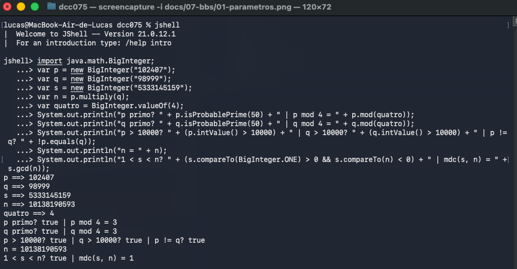
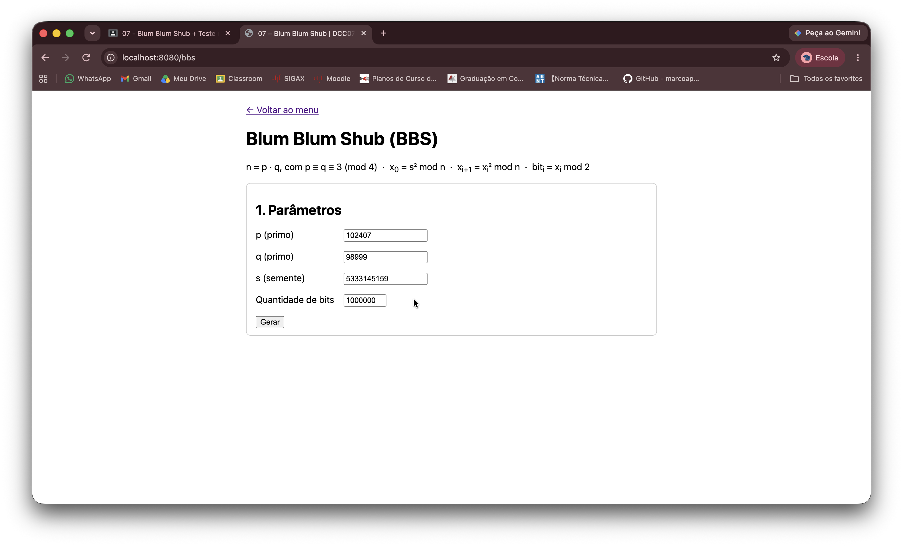
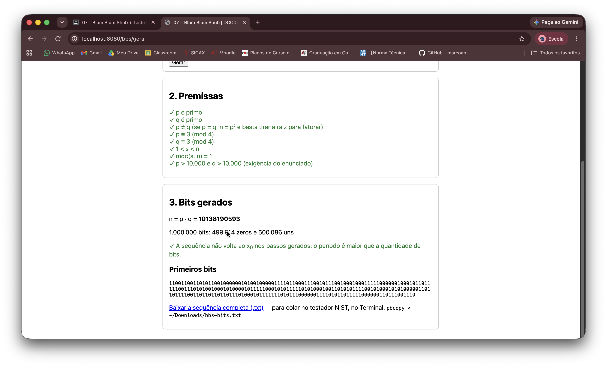
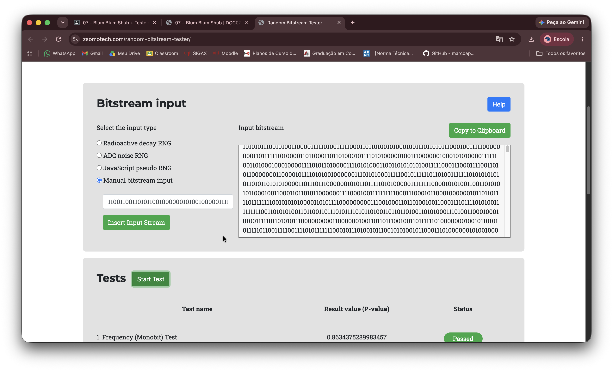
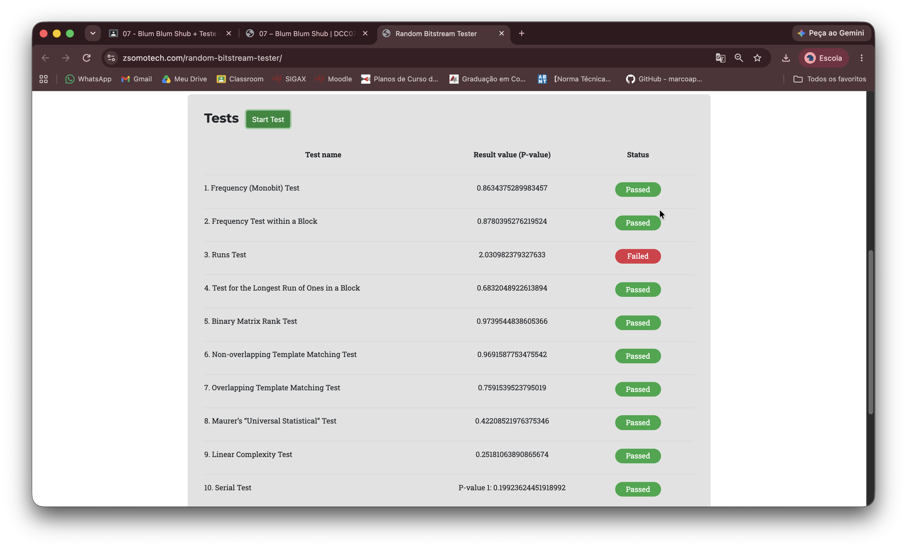
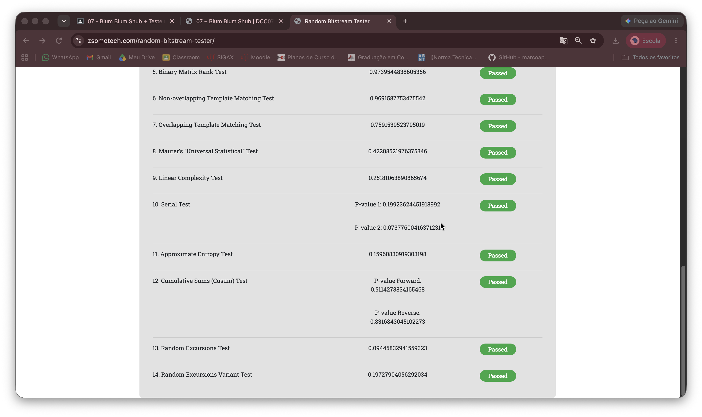

# Atividade 07 – Blum Blum Shub (BBS)

> Implementar o Blum Blum Shub escolhendo números p e q maiores que 10000 que atendam às premissas do
> algoritmo. Realizar testes na suíte NIST. Enviar o algoritmo e os valores de "p", "q" e "s" junto com o
> resultado da suíte NIST (print).

## Valores entregues

| Valor | Escolha |
|-------|---------|
| **p** | **102407** |
| **q** | **98999** |
| **s** | **5333145159** (sorteado com `SecureRandom`) |
| n = p · q | 10138190593 (≈ 2³³) |
| Bits testados | 1.000.000 |

## A ideia

O BBS é um gerador pseudoaleatório **criptográfico**: além de parecer aleatório, o próximo bit não deve ser
previsível. Ele eleva um número ao quadrado módulo n repetidamente e usa a paridade de cada resultado:

```
n = p · q                       p e q primos, p ≡ q ≡ 3 (mod 4)
x0 = s² mod n                   1 < s < n, mdc(s, n) = 1
x(i+1) = x(i)² mod n
bit(i) = x(i) mod 2             (bit menos significativo)
```

| Premissa | Por quê | p = 102407, q = 98999, s = 5333145159 |
|----------|---------|---------------------------------------|
| p e q primos, p ≠ q | a segurança vem da dificuldade de fatorar n; com p = q, basta tirar a raiz | ✓ |
| p ≡ q ≡ 3 (mod 4) | x → x² vira uma permutação dos resíduos quadráticos ("primos de Blum") | 102407 mod 4 = 3, 98999 mod 4 = 3 ✓ |
| mdc(s, n) = 1 | com fator comum, a sequência degenera | ✓ |
| p, q > 10000 | exigência do enunciado | ✓ |

**Exemplo à mão** (p = 7, q = 11, n = 77, s = 3):

```
x0 = 9 → x1 = 81 mod 77 = 4 → x2 = 16 → x3 = 256 mod 77 = 25 → x4 = 625 mod 77 = 9 = x0
bits = 0, 0, 1, 1, 0, 0, 1, 1, ...     (período 4)
```

Com primos de Blum, a sequência é **puramente periódica**: ela sempre volta exatamente ao x0. Se o período
fosse menor que a quantidade de bits gerada, a sequência se repetiria e reprovaria nos testes.

### Por que esses p e q

Além das premissas, p e q são primos **"especiais"** (p = 2p₁ + 1, com p₁ = 2p₂ + 1 e p₁, p₂ primos):
102407 = 2·51203 + 1, 51203 = 2·25601 + 1; 98999 = 2·49499 + 1, 49499 = 2·24749 + 1. É a condição do artigo
original para maximizar o período, que divide λ(λ(n)). Com esses valores, a sequência só volta ao x0 depois de
**1.267.198.298 passos**, muito acima do 1.000.000 de bits testados. O código confirma que não há repetição
dentro dos bits gerados (teste `valoresDaAtividadeNaoSeRepetemEmUmMilhaoDePassos` e aviso na tela).

## Resultado da suíte NIST

Os 1.000.000 de bits foram testados no testador indicado no enunciado
([random-bitstream-tester](https://mzsoltmolnar.github.io/random-bitstream-tester/)), que implementa 14 testes
da NIST SP 800-22. Critério: **p-value ≥ 0,01** (α = 1%).

| # | Teste | p-value (testador online) | Status |
|---|-------|---------------------------|--------|
| 1 | Frequency (Monobit) | 0,8634 | Passed |
| 2 | Frequency within a Block | 0,8780 | Passed |
| 3 | Runs | **2,0310** | **Failed** (ver abaixo) |
| 4 | Longest Run of Ones in a Block | 0,6832 | Passed |
| 5 | Binary Matrix Rank | 0,9740 | Passed |
| 6 | Non-overlapping Template Matching | 0,9692 | Passed |
| 7 | Overlapping Template Matching | 0,7592 | Passed |
| 8 | Maurer's Universal Statistical | 0,4221 | Passed |
| 9 | Linear Complexity | 0,2518 | Passed |
| 10 | Serial | 0,1992 / 0,0738 | Passed |
| 11 | Approximate Entropy | 0,1596 | Passed |
| 12 | Cumulative Sums | 0,5114 / 0,8317 | Passed |
| 13 | Random Excursions | 0,0945 | Passed |
| 14 | Random Excursions Variant | 0,1973 | Passed |

### O "Failed" no Runs Test é um erro do testador

Um p-value é uma probabilidade, então fica sempre entre 0 e 1. O valor **2,031 é matematicamente impossível**:
o "Failed" vem de um erro de cálculo do testador online, que avisa que não é a implementação oficial do NIST.

Calculando o Runs Test pela fórmula da SP 800-22 (seção 2.3) para estes bits:

```
π = 500.086 / 1.000.000 = 0,500086        pré-teste |π − 1/2| = 0,000086 < 2/√n = 0,002  ✓
V_obs (total de sequências) = 499.106      esperado 2nπ(1−π) ≈ 500.000
p-value = erfc( |V_obs − 2nπ(1−π)| / (2·√(2n)·π(1−π)) ) = erfc(1,2643) = 0,0738  ≥ 0,01  → aprovado
```

Para confirmar, o mesmo arquivo foi testado na **implementação oficial em C do NIST (sts-2.1.2)**, com os
parâmetros padrão. O Runs Test deu **p-value = 0,073781 (SUCCESS)**, e todos os testes passaram:

| Teste (STS oficial) | p-value |
|---------------------|---------|
| Frequency | 0,8634 |
| BlockFrequency | 0,8780 |
| **Runs** | **0,0738** |
| LongestRun | 0,6832 |
| Rank | 0,9740 |
| FFT (Spectral, não existe no testador online) | 0,2329 |
| NonOverlappingTemplate | 144 de 148 templates aprovados (esperado: ~1,5 reprovações ao acaso com α = 1%) |
| OverlappingTemplate | 0,7592 |
| Universal | 0,4221 |
| LinearComplexity | 0,8310 |
| Serial | 0,9770 / 0,8616 |
| ApproximateEntropy | 0,9082 |
| CumulativeSums | 0,5114 / 0,6634 |
| RandomExcursions | 8 estados, todos ≥ 0,01 (menor: 0,0945) |
| RandomExcursionsVariant | 18 estados, todos ≥ 0,01 (menor: 0,1973) |

Os testes em que os dois coincidem (Frequency, BlockFrequency, LongestRun, Rank, Overlapping, Universal,
Random Excursions) dão o mesmo p-value. Nos outros, os valores diferem porque o testador online usa tamanhos de
bloco diferentes dos padrões do STS e não os informa. O relatório completo está em
[`docs/07-bbs/nist-sts-oficial.txt`](../../../../../../../docs/07-bbs/nist-sts-oficial.txt).

## Limitações (por que passar no NIST não torna este gerador seguro)

- **n de 34 bits se fatora instantaneamente.** A segurança do BBS é a dificuldade de fatorar n. Com p e q de
  5 dígitos, n = 10138190593 é fatorado em milissegundos, e quem conhece p e q consegue calcular a sequência
  inteira, inclusive para trás. Na prática, o BBS exige n de 2048 bits ou mais.
- **Testes estatísticos medem viés, não previsibilidade.** A suíte NIST verifica se a sequência *parece*
  aleatória (proporção de 0 e 1, sequências, padrões). Um gerador completamente previsível, como um LCG ou um
  contador cifrado com chave conhecida, também pode passar em todos os testes. Passar no NIST é condição
  necessária, não suficiente.
- **A semente foi publicada.** O enunciado pede o valor de s, mas num uso real a semente é secreta: com p, q e s,
  qualquer um reproduz os bits. Por isso s foi sorteado com `SecureRandom` e não escolhido "à mão".
- **Lento.** Cada bit custa uma multiplicação modular de números grandes. Por isso, na prática, usa-se o CSPRNG
  do sistema operacional (`SecureRandom` no Java) ou geradores determinísticos padronizados (NIST SP 800-90A,
  como CTR_DRBG e HMAC_DRBG).

## Arquivos

```
bbs/
├── BlumBlumShub.java   premissas, geração dos bits (BigInteger) e verificação do período
└── BbsController.java  página da atividade: formulário, premissas ✓/✗, prévia e download dos bits
```

Tela: `src/main/resources/templates/bbs/index.html`
Testes: `src/test/java/br/ufjf/dcc075/bbs/BlumBlumShubTest.java`

## Como rodar

Suba a aplicação (veja o [README principal](../../../../../../../README.md)) e acesse **http://localhost:8080/bbs**.
A página é pública, não exige login.

1. O formulário já vem com p, q, s e 1.000.000 de bits. Clique em **Gerar**.
2. A tela mostra cada premissa com ✓/✗, n, a contagem de zeros e uns, a checagem do período e os primeiros bits.
3. **Baixar a sequência completa (.txt)** gera o arquivo para a suíte NIST. No macOS, `pbcopy < ~/Downloads/bbs-bits.txt`
   copia os bits para colar no testador ("Manual bitstream input").

Testes automatizados (exemplo à mão, bits conferidos com Python, premissas, período, entradas inválidas):

```bash
./mvnw test -Dtest=BlumBlumShubTest
```

## Segurança da aplicação

- **`BigInteger` em vez de `long`:** com n ≈ 10¹⁰, x² chega a ≈ 10²⁰ e estouraria o `long` em silêncio,
  gerando bits errados sem nenhum erro (CWE-190).
- **Entrada validada no servidor** (CWE-20): p, q e s só com dígitos (até 30) e no máximo 10⁶ bits. O limite
  evita que alguém peça números gigantes ou bilhões de bits e trave o servidor (CWE-400).
- Premissa não atendida vira mensagem controlada pelo código, sem stack trace (CWE-209).
- Formulário com token **CSRF** (`th:action`) e saída com `th:text`, que escapa HTML (XSS).

## Capturas de tela

**1. Verificação das premissas** no `jshell`



**2. Tela da atividade** com os valores escolhidos



**3. Resultado:** todas as premissas atendidas, 499.914 zeros e 500.086 uns, sem repetição no período



**4. Sequência de 1.000.000 de bits** inserida no testador NIST



**5 e 6. Resultado dos 14 testes** (o "Failed" do Runs Test é o erro do testador explicado acima)





## Uso de IA

Nesta atividade, a IA (Claude) foi usada para:

- explicar o BBS, o papel de cada premissa, o período e os limites dos testes estatísticos;
- escolher p, q (primos especiais) e sortear s, conferindo o período com uma implementação em Python;
- gerar o código das classes, da tela, dos testes e deste README;
- identificar o erro do Runs Test no testador online e conferir os bits na implementação oficial do NIST (sts-2.1.2).

A integração ao projeto, a execução dos testes, a geração dos bits na tela e os testes no testador NIST foram feitos por mim.
