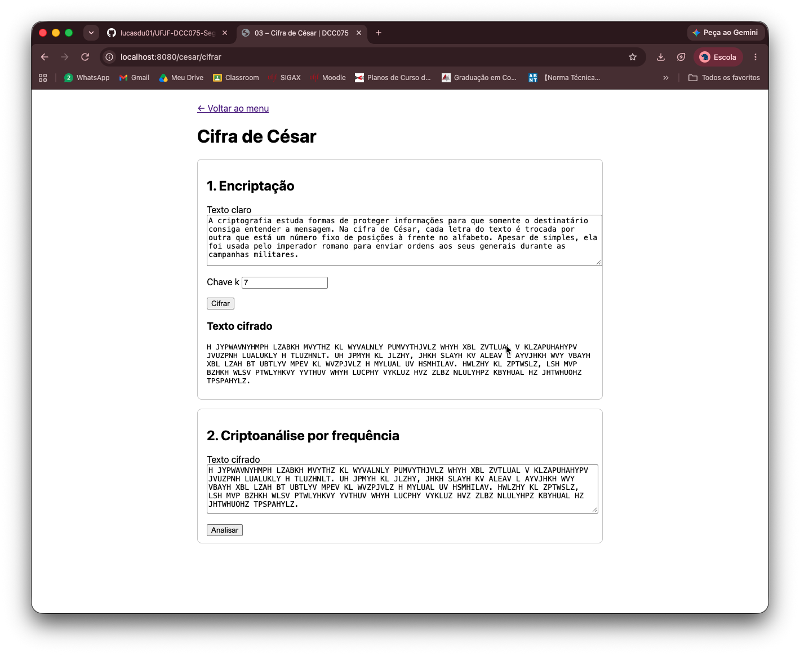
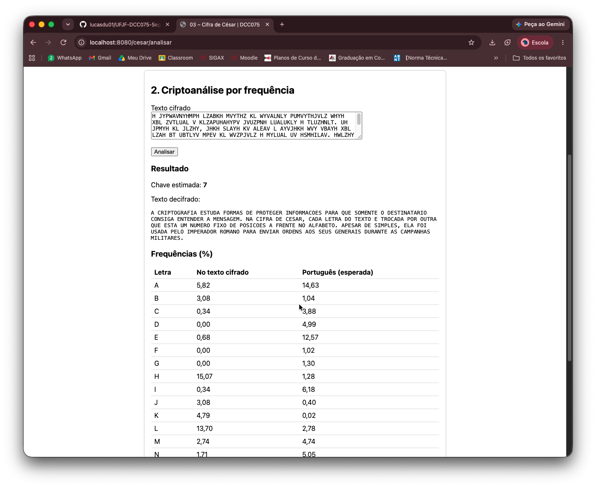
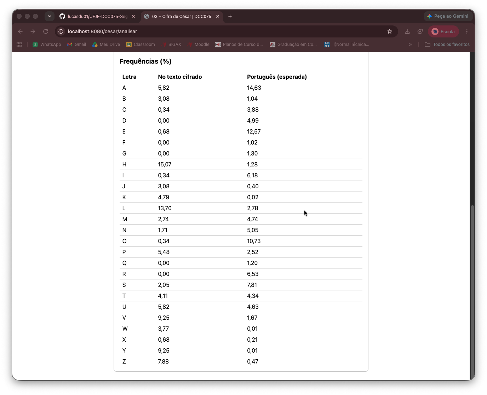
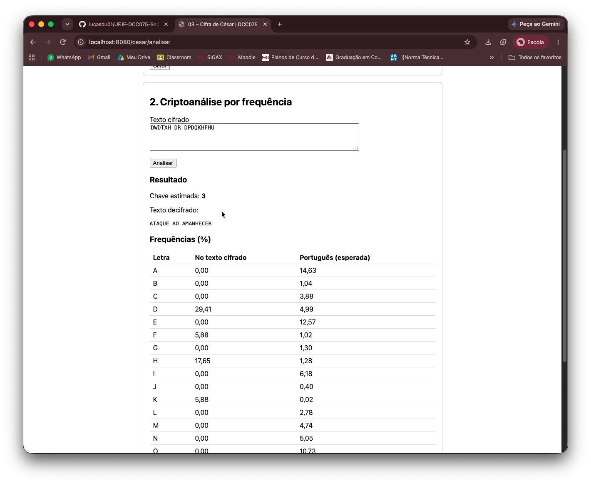

# Atividade 03 – Cifra de César + criptoanálise por frequência

> 1. Implementar a cifra de César, com deslocamento (chave k) de 1 a N. Apenas a encriptação é obrigatória.
> 2. Implementar uma criptoanálise do exercício anterior com base na
>    [frequência de letras](https://pt.wikipedia.org/wiki/Frequ%C3%AAncia_de_letras).

## A ideia

A **cifra de César** troca cada letra pela que está `k` posições à frente no alfabeto.
Numerando as letras (A=0 … Z=25):

```
E(x) = (x + k) mod 26          D(y) = (y − k) mod 26
```

Decifrar é o mesmo que cifrar com `−k`, então um único método faz as duas coisas.

Ela é fácil de quebrar por dois motivos:

- **Poucas chaves:** só existem 25 deslocamentos úteis (`k=26` volta ao texto original).
- **A estatística da língua passa intacta:** a cifra só renomeia as letras. Se o **A** é a letra
  mais comum do português (14,63%), com `k=3` o **D** passa a ser a mais comum do texto cifrado.
  O histograma do cifrado é o do português deslocado `k` posições.

A criptoanálise explora o segundo ponto: descobre `k` só olhando o texto cifrado.

## Como funciona

### Encriptação (`CifraCesar`)

1. O texto é **normalizado**: os acentos são removidos (`á→A`, `ç→C`) e tudo vai para maiúsculas,
   de forma que o alfabeto fique só A–Z, o mesmo da tabela de frequências.
2. Cada letra é deslocada com `Math.floorMod(x + k, 26)`. O `floorMod` aceita qualquer `k`:
   `k=29` equivale a `k=3`, e `k=−3` (decifrar) equivale a `k=23`.
3. Espaços, pontuação e dígitos passam inalterados.

A chave precisa ser `k ≥ 1`, regra validada **no servidor**. O `min="1"` do HTML pode ser contornado.

### Criptoanálise (`AnaliseFrequencia`)

1. Calcula a frequência (%) de cada letra no texto cifrado. Só as letras entram na conta.
2. Para cada chave candidata `k` (0 a 25), compara o histograma "desfeito" com o do português usando o
   **qui-quadrado**:

   ```
   χ²(k) = Σ (observado − esperado)² / esperado
   ```

   Aqui, "observado" para a letra clara `i` é a frequência da letra cifrada `(i + k) mod 26`.
3. O `k` com **menor χ²** é o que deixa o texto mais parecido com português.
4. O texto é decifrado com `cifrar(cifrado, −k)`.

O χ² usa o histograma inteiro, e não só a letra mais frequente. Por isso é mais robusto do que
simplesmente supor que "a letra campeã é o A".

**Exemplo à mão** (`k = 3`):

```
Claro:   ATAQUE AO AMANHECER
Cifrado: DWDTXH DR DPDQKHFHU      → D aparece 5 vezes em 17 letras (29%): D ↔ A, logo k = 3
```

## Arquivos

```
cesar/
├── CifraCesar.java          encriptação (e decriptação com −k)
├── AnaliseFrequencia.java   frequências, tabela do português e estimativa de k por χ²
└── CesarController.java     página da atividade: formulários de cifrar e de analisar
```

Tela: `src/main/resources/templates/cesar/index.html`
Testes: `src/test/java/br/ufjf/dcc075/cesar/`

## Como rodar

Suba a aplicação (veja o [README principal](../../../../../../../README.md)) e acesse **http://localhost:8080/cesar**.
A página é pública, não exige login.

1. **Encriptação:** digite um texto e uma chave `k` e clique em *Cifrar*.
2. **Criptoanálise:** o texto cifrado já aparece no segundo formulário. Clique em *Analisar* para ver
   a chave estimada, o texto decifrado e a tabela de frequências (cifrado × português).

Testes automatizados (cifram um parágrafo com cada chave de 1 a 25 e conferem se a análise recupera todas):

```bash
./mvnw test -Dtest='CifraCesarTest,AnaliseFrequenciaTest'
```

## Limitações

- **Textos curtos podem enganar a análise.** O método é estatístico e precisa de letras suficientes.
  `ATAQUE AO AMANHECER` (17 letras, A repetido) foi quebrado corretamente. Já `FUJA HOJE`, cifrado com `k=3`
  (`IXMD KRMH`), foi estimado como `k=4` (`ETIZ GNID`): com 8 letras e nenhum A, E ou O,
  o histograma não se parece com o do português.
- A tabela de frequências é do português. Um texto em outra língua pode levar a uma chave errada.
- O texto decifrado sai em maiúsculas e sem acentos, por causa da normalização.

## Segurança

- **A cifra de César não oferece segurança real.** Ela não tem *difusão*: a estatística do texto claro
  aparece no cifrado, e esta atividade mostra que dá para quebrá-la automaticamente.
  Cifras modernas (como a estrutura de Feistel da atividade 04) existem para eliminar esse padrão.
- A chave `k` é validada no servidor (CWE-20), e não só no navegador.
- Os formulários são POST com token **CSRF** (`th:action`), e toda a saída usa `th:text`,
  que escapa HTML: um `<script>` digitado aparece como texto e não executa (XSS).

## Capturas de tela

**1. Encriptação** do parágrafo de teste com `k = 7`



**2. Criptoanálise:** chave `k = 7` recuperada e texto decifrado só a partir do cifrado



**3. Tabela de frequências:** os picos do português (A, E, O) reaparecem deslocados em H, L e V



**4. Texto curto** (`DWDTXH DR DPDQKHFHU`): `k = 3` recuperado



## Uso de IA

Nesta atividade, a IA (Claude) foi usada para:

- explicar a cifra de César, a análise de frequência e o teste qui-quadrado;
- discutir o plano da solução e a divisão em passos;
- gerar o código das classes, da tela, dos testes e deste README;
- encontrar um exemplo de texto curto em que a análise falha.

A integração ao projeto, a execução dos testes e a validação na tela foram feitas por mim.
