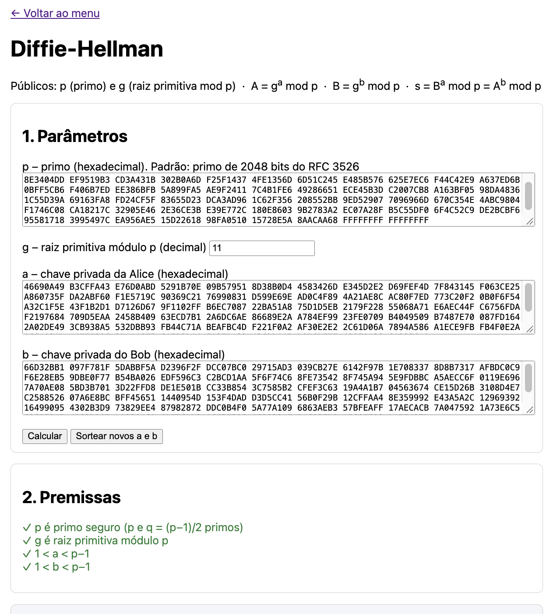
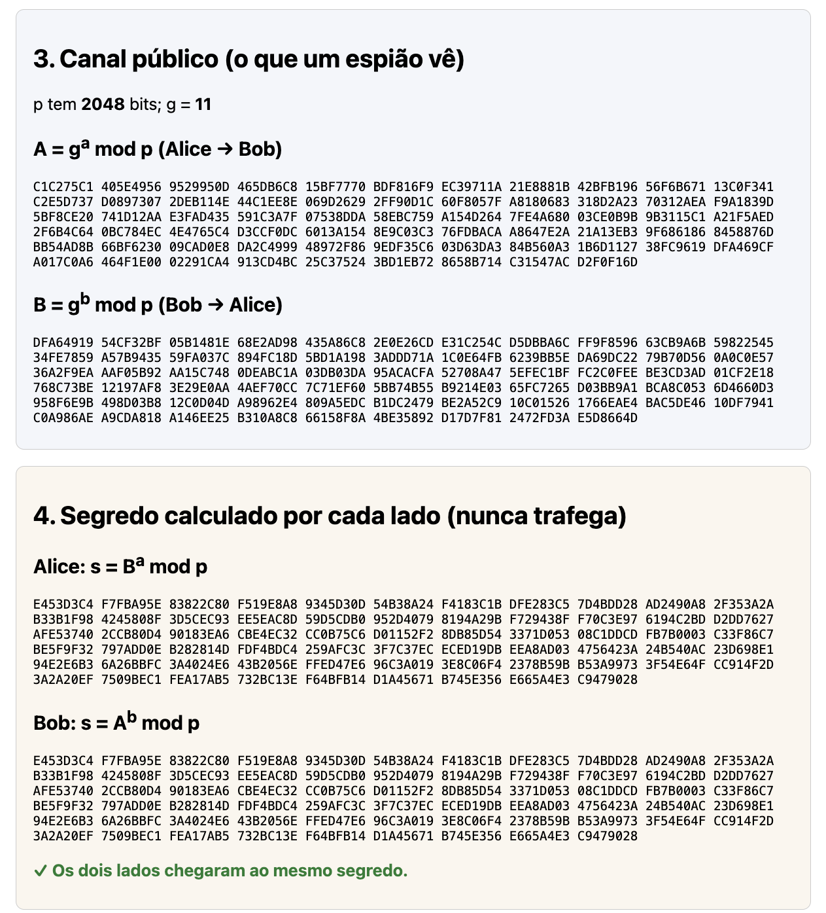

# Atividade 08 – Diffie-Hellman (DH)

> Implementar um DH (Diffie-Hellman) para compartilhamento de segredo (valor de s). Enviar o código e valores
> das variáveis escolhidos (p, g, a, b, e calculados, como o A e B).

## A ideia

Alice e Bob combinam um segredo s por um canal público, sem nunca transmiti-lo:

```
Públicos: p (primo) e g (raiz primitiva mod p)
Alice: a (secreto)  →  envia A = gᵃ mod p
Bob:   b (secreto)  →  envia B = gᵇ mod p
s = Bᵃ mod p = Aᵇ mod p = gᵃᵇ mod p
```

Quem escuta vê p, g, A e B, mas para chegar a s precisaria descobrir a ou b (problema do logaritmo discreto).

- **p:** primo de 2048 bits do RFC 3526 (grupo 14). É um primo seguro (p = 2q + 1, com q primo), o que permite
  verificar a raiz primitiva testando só g² ≢ 1 e g^q ≢ 1 (mod p).
- **g = 11:** menor raiz primitiva módulo p (o g = 2 do RFC não é raiz primitiva).
- **a e b:** sorteados com `SecureRandom`.

## Valores

Em hexadecimal, exceto g.

```
p (RFC 3526, grupo 14, 2048 bits):
FFFFFFFF FFFFFFFF C90FDAA2 2168C234 C4C6628B 80DC1CD1 29024E08 8A67CC74
020BBEA6 3B139B22 514A0879 8E3404DD EF9519B3 CD3A431B 302B0A6D F25F1437
4FE1356D 6D51C245 E485B576 625E7EC6 F44C42E9 A637ED6B 0BFF5CB6 F406B7ED
EE386BFB 5A899FA5 AE9F2411 7C4B1FE6 49286651 ECE45B3D C2007CB8 A163BF05
98DA4836 1C55D39A 69163FA8 FD24CF5F 83655D23 DCA3AD96 1C62F356 208552BB
9ED52907 7096966D 670C354E 4ABC9804 F1746C08 CA18217C 32905E46 2E36CE3B
E39E772C 180E8603 9B2783A2 EC07A28F B5C55DF0 6F4C52C9 DE2BCBF6 95581718
3995497C EA956AE5 15D22618 98FA0510 15728E5A 8AACAA68 FFFFFFFF FFFFFFFF

g: 11 (decimal)

a (privada da Alice):
46690A49 B3CFFA43 E76D0ABD 5291B70E 09B57951 8D38B0D4 4583426D E345D2E2
D69FEF4D 7F843145 F063CE25 A860735F DA2ABF60 F1E5719C 90369C21 76990831
D599E69E AD0C4F89 4A21AE8C AC80F7ED 773C20F2 0B0F6F54 A32C1F5E 43F1B2D1
D7126D67 9F1102FF B6EC7087 22BA51A8 75D1D5EB 2179F228 55068A71 E6AEC44F
C6756FDA F2197684 709D5EAA 2458B409 63ECD7B1 2A6DC6AE 86689E2A A784EF99
23FE0709 B4049509 B7487E70 087FD164 2A02DE49 3CB938A5 532DBB93 FB44C71A
BEAFBC4D F221F0A2 AF30E2E2 2C61D06A 7894A586 A1ECE9FB FB4F0E2A 0C8103AD
A47EC896 2B1A487E C1F52DA4 FA25D139 42CBD115 D8B6D75F 488E0139 C429FC40

b (privada do Bob):
66D32BB1 097F781F 5DABBF5A D2396F2F DCC07BC0 29715AD3 039CB27E 6142F97B
1E708337 8D8B7317 AFBDC0C9 F6E28EB5 9DBE0F77 B54BA026 EDF596C3 C2BCD1AA
5F6F74C6 8FE73542 8F745A94 5E9FDBBC A5AECC6F 0119E696 7A70AE08 5BD3B701
3D22FFD8 DE1E501B CC33B854 3C7585B2 CFEF3C63 19A4A1B7 04563674 CE15D26B
3108D4E7 C2588526 07A6E8BC BFF45651 1440954D 153F4DAD D3D5CC41 56B0F29B
12CFFAA4 8E359992 E43A5A2C 12969392 16499095 4302B3D9 73829EE4 87982872
DDC0B4F0 5A77A109 6863AEB3 57BFEAFF 17AECACB 7A047592 1A73E6C5 C9695947
4062D905 D03294C0 6BF7CDD2 ACC3529C 0652231F B1C837D9 1569F728 DA5F427D

A = g^a mod p:
C1C275C1 405E4956 9529950D 465DB6C8 15BF7770 BDF816F9 EC39711A 21E8881B
42BFB196 56F6B671 13C0F341 C2E5D737 D0897307 2DEB114E 44C1EE8E 069D2629
2FF90D1C 60F8057F A8180683 318D2A23 70312AEA F9A1839D 5BF8CE20 741D12AA
E3FAD435 591C3A7F 07538DDA 58EBC759 A154D264 7FE4A680 03CE0B9B 9B3115C1
A21F5AED 2F6B4C64 0BC784EC 4E4765C4 D3CCF0DC 6013A154 8E9C03C3 76FDBACA
A8647E2A 21A13EB3 9F686186 8458876D BB54AD8B 66BF6230 09CAD0E8 DA2C4999
48972F86 9EDF35C6 03D63DA3 84B560A3 1B6D1127 38FC9619 DFA469CF A017C0A6
464F1E00 02291CA4 913CD4BC 25C37524 3BD1EB72 8658B714 C31547AC D2F0F16D

B = g^b mod p:
DFA64919 54CF32BF 05B1481E 68E2AD98 435A86C8 2E0E26CD E31C254C D5DBBA6C
FF9F8596 63CB9A6B 59822545 34FE7859 A57B9435 59FA037C 894FC18D 5BD1A198
3ADDD71A 1C0E64FB 6239BB5E DA69DC22 79B70D56 0A0C0E57 36A2F9EA AAF05B92
AA15C748 0DEABC1A 03DB03DA 95ACACFA 52708A47 5EFEC1BF FC2C0FEE BE3CD3AD
01CF2E18 768C73BE 12197AF8 3E29E0AA 4AEF70CC 7C71EF60 5BB74B55 B9214E03
65FC7265 D03BB9A1 BCA8C053 6D4660D3 958F6E9B 498D03B8 12C0D04D A98962E4
809A5EDC B1DC2479 BE2A52C9 10C01526 1766EAE4 BAC5DE46 10DF7941 C0A986AE
A9CDA818 A146EE25 B310A8C8 66158F8A 4BE35892 D17D7F81 2472FD3A E5D8664D

s = B^a mod p = A^b mod p:
E453D3C4 F7FBA95E 83822C80 F519E8A8 9345D30D 54B38A24 F4183C1B DFE283C5
7D4BDD28 AD2490A8 2F353A2A B33B1F98 4245808F 3D5CEC93 EE5EAC8D 59D5CDB0
952D4079 8194A29B F729438F F70C3E97 6194C2BD D2DD7627 AFE53740 2CCB80D4
90183EA6 CBE4EC32 CC0B75C6 D01152F2 8DB85D54 3371D053 08C1DDCD FB7B0003
C33F86C7 BE5F9F32 797ADD0E B282814D FDF4BDC4 259AFC3C 3F7C37EC ECED19DB
EEA8AD03 4756423A 24B540AC 23D698E1 94E2E6B3 6A26BBFC 3A4024E6 43B2056E
FFED47E6 96C3A019 3E8C06F4 2378B59B B53A9973 3F54E64F CC914F2D 3A2A20EF
7509BEC1 FEA17AB5 732BC13E F64BFB14 D1A45671 B745E356 E665A4E3 C9479028
```

## Arquivos

```
dh/
├── DiffieHellman.java  primo seguro, raiz primitiva, chaves privadas, chaves públicas e segredo
└── DhController.java   página da atividade
```

Tela: `src/main/resources/templates/dh/index.html`
Testes: `src/test/java/br/ufjf/dcc075/dh/DiffieHellmanTest.java`
Relatório (PDF): [`docs/08-dh/relatorio_dh.pdf`](../../../../../../../docs/08-dh/relatorio_dh.pdf)

## Como rodar

Suba a aplicação (veja o [README principal](../../../../../../../README.md)) e acesse **http://localhost:8080/dh**.
O formulário já vem com os valores acima: clique em **Calcular**. **Sortear novos a e b** gera outras chaves privadas.

```bash
./mvnw test -Dtest=DiffieHellmanTest
```

## Capturas de tela





## Uso de IA

Nesta atividade, a IA (Claude) foi usada para explicar o Diffie-Hellman, escolher p e encontrar g, sortear a e b
e conferir A, B e s em Python, e gerar o código, os testes, este README e o relatório.
A execução dos testes e a validação na tela foram feitas por mim.
