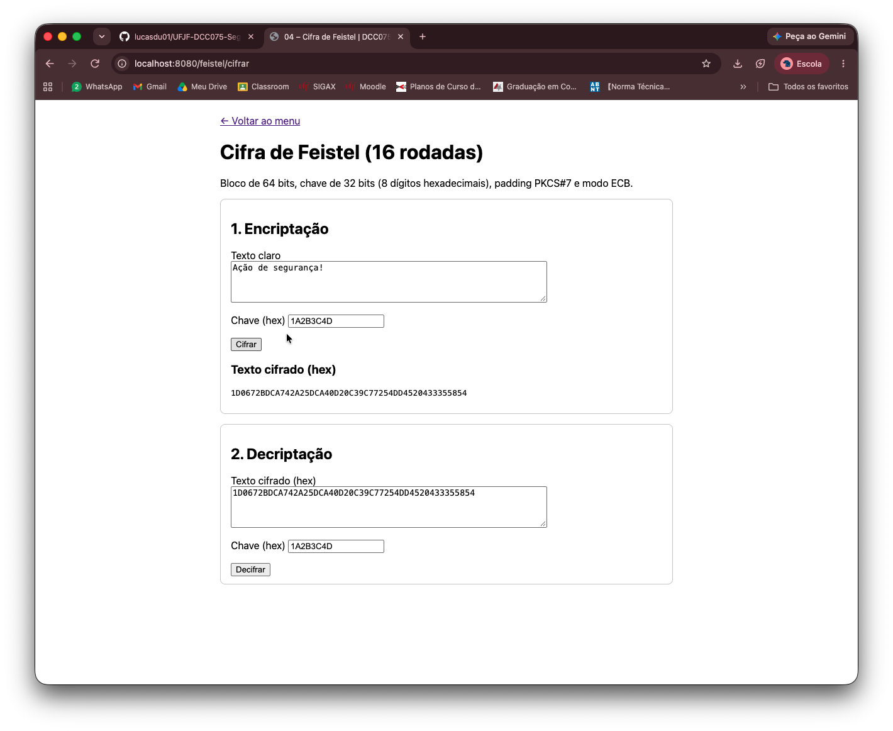
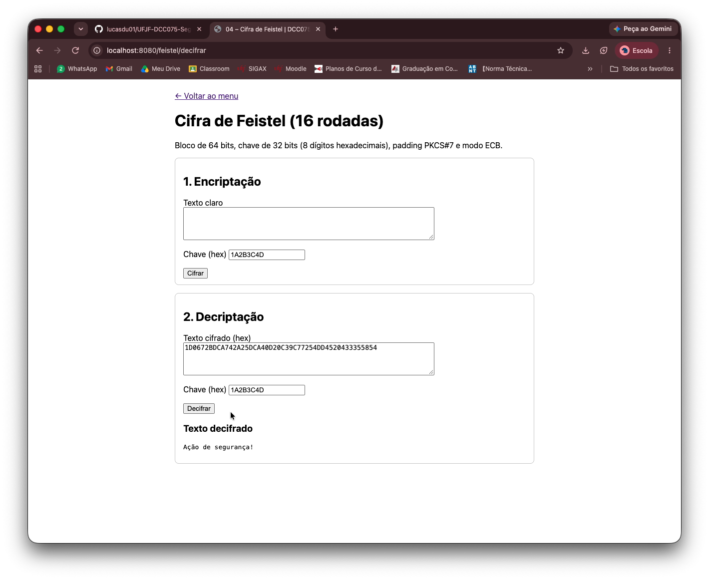
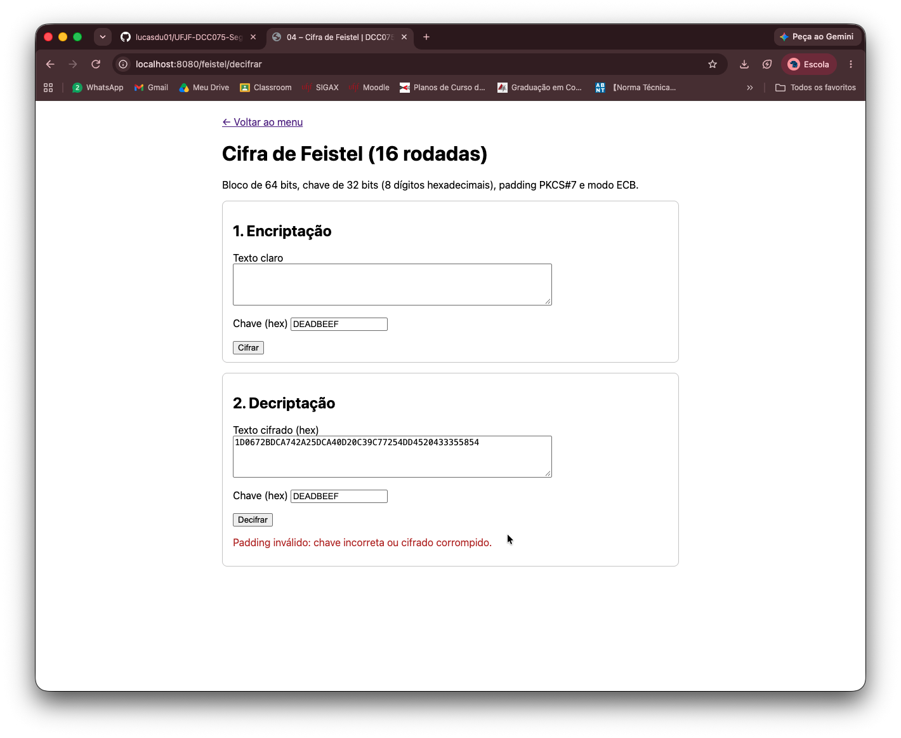
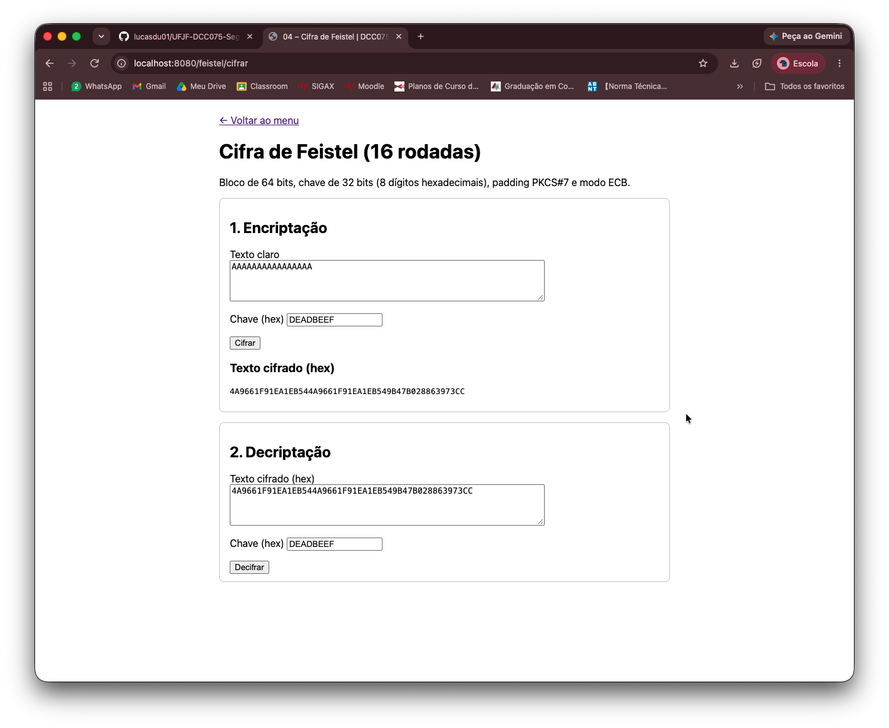
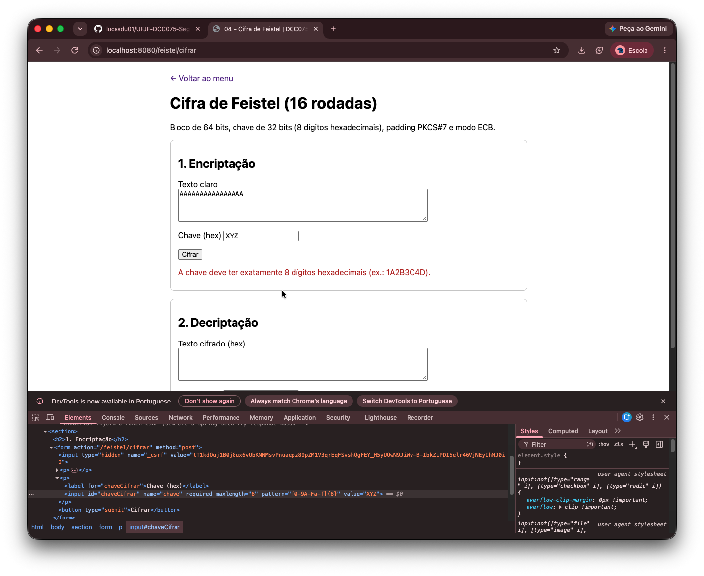

# Atividade 04 – Cifra de Feistel (16 rodadas)

> Implementar uma Cifra de Feistel com 16 rodadas, com encriptação e decriptação, código comentado
> e instruções de execução. As operações precisam permitir reversão (ex.: XOR). A função `f` pode ser simples.

## A ideia

Para decriptar, normalmente seria preciso inverter cada operação da cifra. A **estrutura de Feistel**
elimina essa exigência: a função de rodada `f` pode ser **qualquer uma**, até não inversível, e a cifra
continua reversível.

O bloco é dividido em duas metades, `L` e `R`, e cada rodada faz:

```
L(i) = R(i-1)
R(i) = L(i-1) XOR f(R(i-1), K(i))
```

Para voltar, basta recalcular `f` (nunca invertê-la) e usar o fato de o XOR ser autorreversível:

```
R(i-1) = L(i)
L(i-1) = R(i) XOR f(L(i), K(i))      porque (a XOR b) XOR b = a
```

Na prática, a **decriptação é o mesmo algoritmo com as subchaves na ordem inversa** (K16 … K1).
O algoritmo termina com uma troca final das metades, e é essa troca que permite reaproveitá-lo.

**Exemplo à mão** (bloco de 8 bits, 2 rodadas, `f(R, K) = R XOR K`, `K1 = 0110`, `K2 = 1001`):

```
Encriptação de L0=1010, R0=0011
R1 = 1010 ⊕ (0011⊕0110) = 1111     L1 = 0011
R2 = 0011 ⊕ (1111⊕1001) = 0101     L2 = 1111
Troca final → cifrado = 0101 1111

Decriptação (mesmo algoritmo, chaves K2, K1) de L=0101, R=1111
R = 0101 ⊕ (1111⊕1001) = 0011      L = 1111
R = 1111 ⊕ (0011⊕0110) = 1010      L = 0011
Troca final → 1010 0011 = original ✓
```

## Como funciona

| Parâmetro | Escolha |
|-----------|---------|
| Bloco | 64 bits (`L` e `R` de 32 bits), como no DES |
| Rodadas | 16 |
| Chave | 32 bits, informada como 8 dígitos hexadecimais (ex.: `1A2B3C4D`) |
| Subchaves | `K(i) = chave rotacionada i bits para a esquerda`, i = 1..16 |
| Função `f` | `f(R, K) = rotl(R XOR K, 3)`: XOR com a subchave e rotação de 3 bits |
| Mensagens | texto → bytes UTF-8 → padding PKCS#7 → blocos de 8 bytes (modo ECB) → hexadecimal |

- **Padding PKCS#7:** completa o último bloco com N bytes de valor N. Se o texto já tiver múltiplo
  de 8 bytes, entra um bloco inteiro de padding, para a remoção nunca ser ambígua.
- **Hexadecimal:** os bytes cifrados são binários quaisquer. O hex permite exibi-los e copiá-los.
- **Chave errada:** depois de decriptar, o padding é conferido. Com a chave errada ele quase sempre fica
  inválido e a tela mostra um erro.

## Arquivos

```
feistel/
├── CifraFeistel.java       subchaves, função f, rodadas, padding e conversão texto <-> hex
└── FeistelController.java  página da atividade: formulários de encriptar e decriptar
```

Tela: `src/main/resources/templates/feistel/index.html`
Testes: `src/test/java/br/ufjf/dcc075/feistel/CifraFeistelTest.java`

## Como rodar

Suba a aplicação (veja o [README principal](../../../../../../../README.md)) e acesse **http://localhost:8080/feistel**.
A página é pública, não exige login.

1. **Encriptação:** digite um texto e uma chave de 8 dígitos hex e clique em *Cifrar*.
   O resultado sai em hexadecimal.
2. **Decriptação:** o cifrado e a chave já aparecem no segundo formulário. Clique em *Decifrar* para
   recuperar o texto original. Para ver a falha, troque a chave antes de decifrar.

Testes automatizados (subchaves, `f`, ida e volta de blocos e textos, ECB, chave errada, hex inválido):

```bash
./mvnw test -Dtest=CifraFeistelTest
```

Exemplo para conferir: `Ação de segurança!` com a chave `1A2B3C4D` gera
`1D0672BDCA742A25DCA40D20C39C77254DD4520433355854`.

## Limitações (por que esta cifra não é segura)

O objetivo é entender a estrutura de Feistel, não construir uma cifra forte. Os pontos fracos são conhecidos:

- **`f` linear.** XOR e rotação são operações lineares, então a cifra inteira também é. Um teste mostra isso:
  cifrando `0123456789ABCDEF` e `0123456789ABCDEE` (1 bit de diferença), a diferença entre os cifrados é
  **sempre** `0101041100002000`, **qualquer que seja a chave**, e só 6 dos 64 bits mudam.
  - Numa cifra forte, cerca de metade dos bits mudaria (efeito avalanche), e a diferença dependeria da chave.
  - Essa linearidade permite recuperar a chave com poucos pares texto claro/cifrado (criptoanálise linear e
    diferencial).
  - O DES resolve isso com as **S-boxes**, a parte não linear da sua `f`, que dá a **confusão** de Shannon.
    As 16 rodadas dão a **difusão**.
- **Modo ECB.** Blocos de texto iguais geram blocos cifrados iguais: `AAAAAAAAAAAAAAAA` vira o mesmo bloco
  repetido duas vezes (captura 4). O padrão do texto vaza, como na cifra de César. Os modos CBC e CTR
  evitam isso com um vetor de inicialização.
- **Chave de 32 bits.** São só 2³² (≈ 4,3 bilhões) chaves, que dá para testar todas por força bruta.
  O DES, com 56 bits, foi aposentado por esse motivo; o AES usa 128 a 256.
- **Escalonamento de chave fraco.** Uma chave `00000000` ou `FFFFFFFF` gera 16 subchaves iguais.
- **Padding não é integridade.** Uma chave errada pode, por acaso (cerca de 1 em 256), gerar um padding
  válido e devolver lixo sem erro. Por exemplo, `1A2B3C4C`, que difere em 1 bit da chave certa, faz isso com o
  exemplo acima. Garantir integridade exige MAC ou cifra autenticada (AES-GCM).

## Segurança da aplicação

- A chave e o hexadecimal são validados **no servidor** (CWE-20). O `pattern` do HTML pode ser contornado (captura 5).
- Hex inválido e padding incorreto viram uma mensagem amigável, sem stack trace na tela (CWE-209).
- Formulários com token **CSRF** (`th:action`) e saída com `th:text`, que escapa HTML (XSS).

## Capturas de tela

**1. Encriptação** de `Ação de segurança!` com a chave `1A2B3C4D`



**2. Decriptação** com a mesma chave: o texto original volta



**3. Chave errada** (`DEADBEEF`): o padding não confere



**4. Fraqueza do ECB:** os dois blocos `AAAAAAAA` geram o mesmo bloco cifrado (`4A9661F91EA1EB54` repetido)



**5. Validação no servidor:** chave `XYZ` enviada contornando o `pattern` do HTML



## Uso de IA

Nesta atividade, a IA (Claude) foi usada para:

- explicar a estrutura de Feistel, por que ela é reversível e as fraquezas da proposta (linearidade, ECB, padding);
- discutir as escolhas de bloco, chave, função `f` e modo de operação;
- gerar o código das classes, da tela, dos testes e deste README;
- conferir os resultados com uma simulação independente em Python (incluindo o teste de linearidade).

A integração ao projeto, a execução dos testes e a validação na tela foram feitas por mim.
