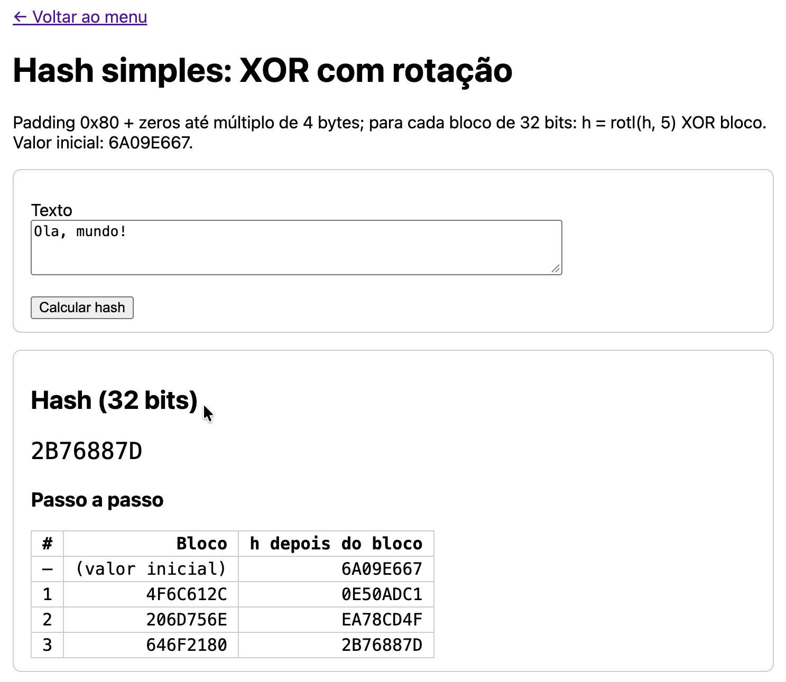

# Atividade 09 – Hash

> 1) Explicar passo a passo o SHA (que pode ser o SHA-256 do vídeo indicado).
> 2) Realizar uma busca sobre os principais algoritmos de hash utilizados atualmente e escrever um texto de,
> ao menos, 200 palavras sobre seus pontos fortes e fracos.
> 3) Gerar um código simples de hash baseado em algo simples, como: utilizando somente XOR bloco a bloco,
> XOR com rotação, etc.

As partes 1 e 2 são textos e estão no relatório [`docs/09-hash/relatorio_hash.pdf`](../../../../../../../docs/09-hash/relatorio_hash.pdf),
junto com a parte 3. Este README trata da parte 3, o código.

## A ideia

Hash de 32 bits que processa a mensagem bloco a bloco:

```
1. Padding: byte 0x80 + zeros até um múltiplo de 4 bytes
2. Divide em blocos de 32 bits
3. h = 6A09E667 (valor inicial, o mesmo H0 do SHA-256)
   para cada bloco: h = rotl(h, 5) XOR bloco
```

Só com XOR, a ordem dos blocos não importaria (`abcdefgh` e `efghabcd` dariam o mesmo hash). A rotação
faz cada bloco "andar" 5 bits a cada passo, então a posição passa a contar.

**Exemplo:** `Ola, mundo!` → blocos `4F6C612C`, `206D756E` e `646F2180` (o último com o padding 0x80):

| Passo | Bloco | h |
|-------|-------|---|
| – | (valor inicial) | 6A09E667 |
| 1 | 4F6C612C | 0E50ADC1 |
| 2 | 206D756E | EA78CD4F |
| 3 | 646F2180 | **2B76887D** |

**Limitações:** a função é linear (XOR e rotação), então é fácil montar colisões: `DCC075!!` e `wxAsPUiG`
têm o mesmo hash, `989B5033`. Também não há efeito avalanche: trocar o último caractere de `Ola, mundo!` por `?`
muda só 4 dos 32 bits do hash (`2B76887D` → `2B76967D`). E com 32 bits, uma colisão aparece ao acaso depois de cerca de
2¹⁶ mensagens.

## Arquivos

```
hash/
├── HashXorRotacao.java  padding, divisão em blocos e XOR com rotação
└── HashController.java  página da atividade: hash e passo a passo
```

Tela: `src/main/resources/templates/hash/index.html`
Testes: `src/test/java/br/ufjf/dcc075/hash/HashXorRotacaoTest.java`

## Como rodar

Suba a aplicação (veja o [README principal](../../../../../../../README.md)) e acesse **http://localhost:8080/hash**.
Digite um texto e clique em **Calcular hash**: a tela mostra o hash e o estado depois de cada bloco.

```bash
./mvnw test -Dtest=HashXorRotacaoTest
```

## Captura de tela

Hash de `Ola, mundo!` com o estado depois de cada bloco



## Uso de IA

Nesta atividade, a IA (Claude) foi usada para explicar o SHA-256 em português com os valores do exemplo do vídeo,
revisar os textos das partes 1 e 2, gerar o código, os testes, este README e o relatório, conferir os valores com
uma implementação em Python e encontrar a colisão de exemplo. A execução dos testes e a validação na tela foram
feitas por mim.
