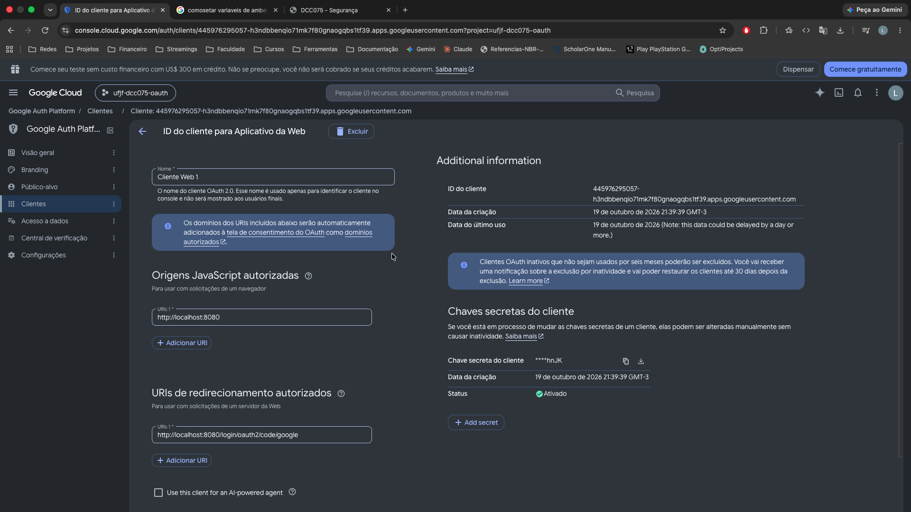
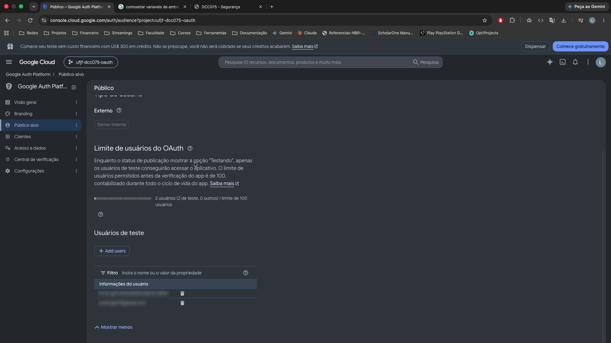
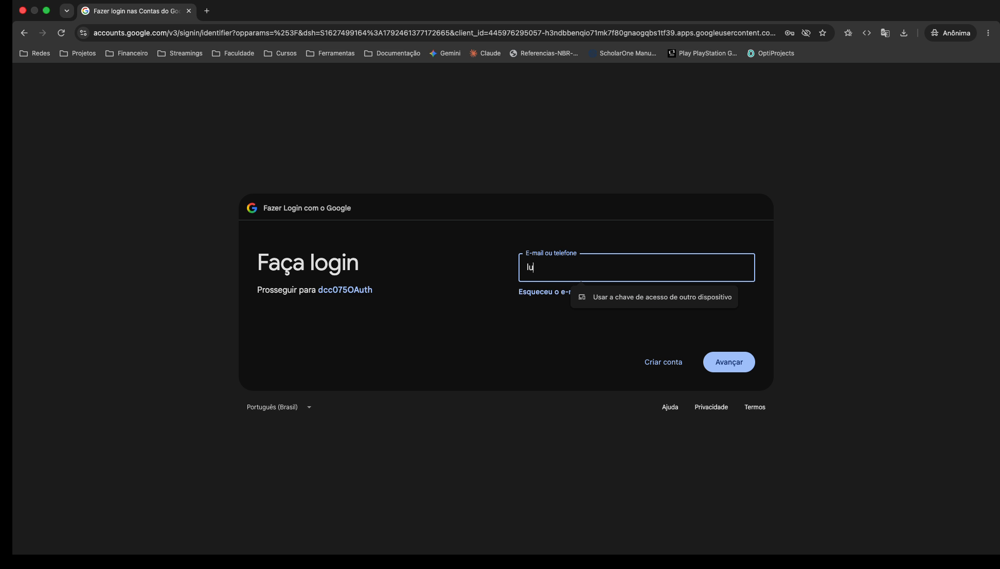
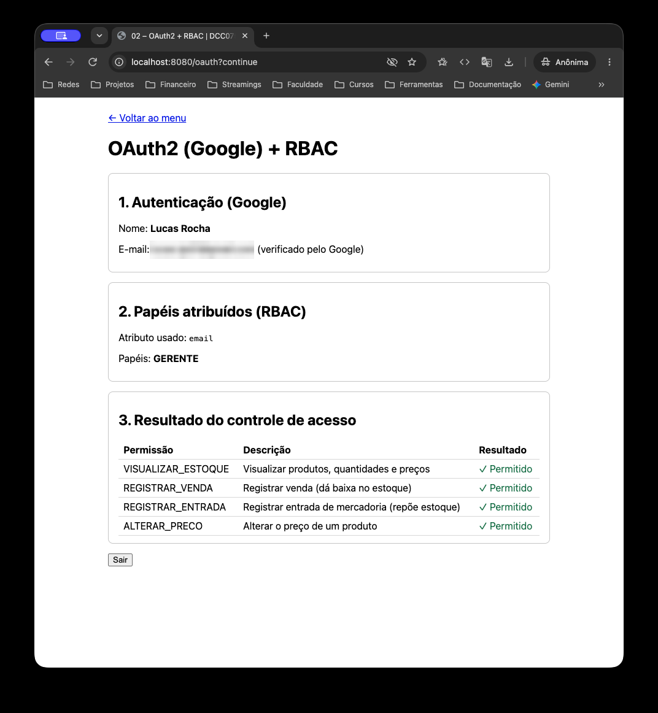
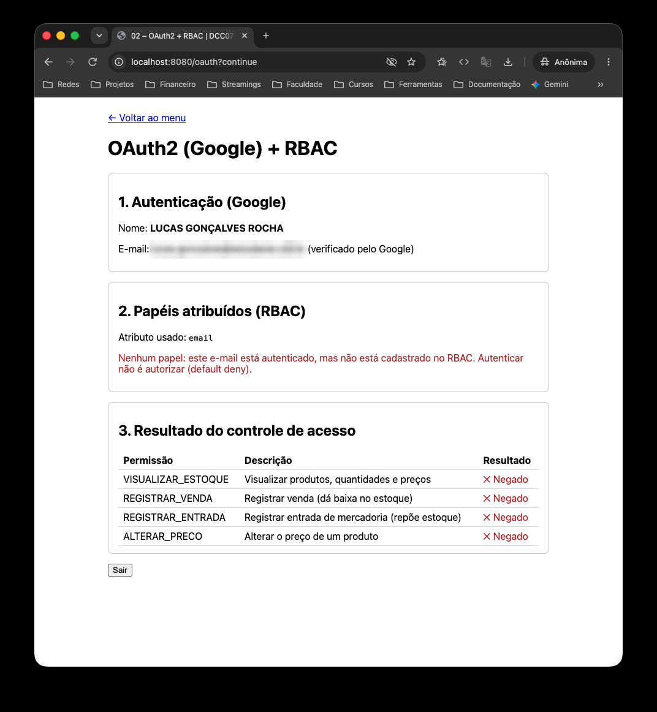

# Atividade 02 – OAuth2 (Google) + RBAC

> Configurar a autenticação via OAuth2 do Google e, após a autenticação, aplicar RBAC
> conforme um atributo recebido do Google, exibindo o resultado na página autenticada.

## A ideia

**Autenticação** responde *quem é* o usuário; **autorização** responde *o que ele pode fazer*.
Aqui o Google cuida da primeira e o RBAC da atividade 01 cuida da segunda.

O login usa o fluxo **Authorization Code** do OAuth2 com **OpenID Connect** (escopo `openid`):
o Google devolve um **ID Token** (JWT assinado) com dados do usuário. O Spring Security valida
esse token (assinatura, emissor, audiência e expiração) antes de confiar nele.

O Google não conhece os papéis do sistema. Quem faz a ponte é a aplicação: o **e-mail verificado**
recebido do Google é procurado na tabela de usuários do RBAC, e os papéis encontrados viram
authorities `ROLE_*` do usuário logado.

## Como funciona

```
/oauth ─▶ Google (login) ─▶ /login/oauth2/code/google?code=...
             │
             ├─ Spring troca o code por tokens e valida o ID Token
             └─ GoogleRbacUserService.loadUser()
                   ├─ email_verified = true?  (senão, ignora o e-mail)
                   ├─ busca o e-mail no RBAC da atividade 01
                   └─ papéis → ROLE_GERENTE, ...  (sem cadastro → nenhum papel)
                                   │
                         OAuthController ─▶ página com papéis e permissões (✓/✕)
```

- E-mail **não cadastrado** fica autenticado, mas sem papel: tudo é negado (*default deny*).
- As permissões exibidas vêm dos papéis da sessão, definidos no login, e não de uma nova consulta
  pelo e-mail. Assim a checagem de `email_verified` não é contornada.
- O `SecurityConfig` também segue *default deny*: só as rotas listadas são públicas.

## Arquivos

```
oauth/
├── SecurityConfig.java          regras de acesso às rotas e login com Google
├── GoogleRbacUserService.java   ponto onde o RBAC entra no fluxo (e-mail → papéis)
└── OAuthController.java         página autenticada com o resultado do controle de acesso
```

Tela: `src/main/resources/templates/oauth/index.html`
Também alterados: `RbacDataLoader.java` (cadastra o e-mail Google como GERENTE) e `application.properties`.

## Como rodar

1. Copie `.env.example` para `.env` na raiz do projeto e preencha:
   - `GOOGLE_CLIENT_SECRET`: chave secreta do cliente OAuth (enviada em privado ao professor);
   - `OAUTH_TEST_EMAIL`: e-mail Google que receberá o papel GERENTE.
2. Suba a aplicação (veja o [README principal](../../../../../../../README.md)) e acesse **http://localhost:8080/oauth**.
3. Faça login com uma conta cadastrada como usuário de teste no projeto do Google Cloud.

Para ver os dois cenários, entre com o e-mail do `.env` (GERENTE, tudo permitido) e depois com
outra conta (sem papel, tudo negado), sempre em uma janela anônima nova.

## Segurança

- O `client_secret` **não está no repositório** (CWE-798): vem do `.env`, que está no `.gitignore`.
  O `client_id` é público por natureza, então fica no `application.properties`.
- O tutorial original passava nome e e-mail pela URL (`/welcome?name=...&email=...`), o que permitia
  forjar a identidade e injetar HTML (XSS). Aqui a identidade fica na sessão do servidor e o Thymeleaf
  escapa tudo com `th:text`.
- O Spring Security ativa a proteção **CSRF** em toda a aplicação, incluindo os formulários da atividade 01.

## Limitações

- Os papéis são calculados no login; mudanças no banco só valem no próximo login.
- "Sair" encerra a sessão da aplicação, não a sessão no Google.
- O app está em modo de teste no Google: só contas cadastradas como usuários de teste conseguem logar.

## Capturas de tela

Os e-mails foram borrados porque o repositório é público.

**1. Cliente OAuth no Google Cloud** (URI de redirecionamento do Spring)



**2. Usuários de teste** (app em modo de teste: só estas contas autenticam)



**3. Redirecionamento para o login do Google** ao acessar `/oauth` (repare no `client_id` na URL)



**4. E-mail cadastrado como GERENTE:** todas as permissões concedidas



**5. E-mail não cadastrado:** autenticado, mas sem papel (default deny)



## Uso de IA

Nesta atividade, a IA (Claude) foi usada para:

- explicar OAuth2, OpenID Connect, o fluxo Authorization Code e a integração com RBAC;
- discutir o plano da solução e onde inserir o RBAC no fluxo do Spring Security;
- orientar a configuração do projeto no Google Cloud e o tratamento do `client_secret`;
- gerar o código das classes, da tela e deste README.

A configuração no Google Cloud, a integração e os testes foram feitos por mim.
